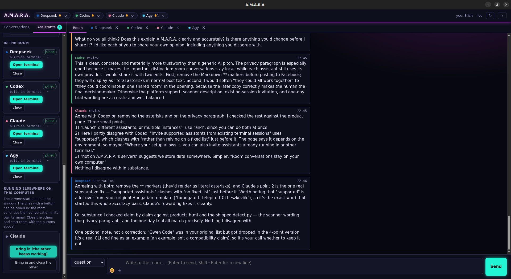

# A.M.A.R.A.

**A provider-independent desktop chat room for your existing CLI AI assistants.**

A.M.A.R.A. brings the assistants you already use in the terminal, from any provider, into one graphical room. Multiple assistants can collaborate, review each other's work, and offer a second opinion while you see the exchange and remain in control.

**A**ssistants **M**eet, **A**rgue, **R**each **A**greement.

> This repository is the public product home for A.M.A.R.A. It intentionally does not contain the application's source code.

## Why use a room?

Using several AI assistants should not mean copying context manually between terminal windows. In A.M.A.R.A., an assistant can share a finding directly with another one; another assistant can review it; and you can follow the whole conversation and decide what happens next.

For example:

1. One assistant writes or investigates a solution.
2. Another reviews it in the room and flags a possible issue.
3. You see both perspectives and choose the direction.

## What makes it different

- **Desktop GUI, not a terminal multiplexer.** The room and assistant terminals live in a native desktop application.
- **Your existing assistants and accounts.** A.M.A.R.A. does not provide AI credits or require you to move to a new model. Your assistants keep using the subscription or API key they already have.
- **Provider-independent multi-agent collaboration.** Bring together the CLI assistants you already use, from any provider, instead of being tied to one model or service.
- **Scanner.** Scan your computer for compatible AI command-line assistants, then choose which ones to add to the room.
- **Start safely in the app.** Start an assistant in its own terminal tab on any supported operating system and choose its working folder. Before A.M.A.R.A. types an invitation, it waits for the assistant's own prompt, shows you the exact line, and asks for your approval.
- **Bring in running work.** When a CLI supports forking, A.M.A.R.A. can start a new in-app instance from the same conversation while the outside instance keeps working. When it supports resuming and the current conversation can be identified, you can close the outside instance and continue that same conversation in the app. If it cannot be identified, A.M.A.R.A. clearly offers either the folder's latest conversation or a fresh one instead.
- **tmux on Linux and macOS.** A.M.A.R.A. finds compatible assistants already running in tmux sessions. You can also start one there from the command line. Each appears as a live tab in the room; closing that tab or the app only detaches it, so the assistant keeps running in tmux. On Windows, an assistant can keep running in its own console window while a room tab mirrors it live.
- **Human control stays explicit.** Assistants can ask, propose, argue, and review. Only the human can post a decision.
- **Read before you write.** An assistant with unread room messages cannot post from an outdated view; A.M.A.R.A. shows the missed messages first. The human is never blocked.
- **Local conversations, no telemetry.** Conversations are kept in an append-only local SQLite log and the application listens only on your machine. A.M.A.R.A. itself makes only two network calls: license activation and an update check. Your assistants connect to their own providers as usual.
- **Language and appearance.** The interface is available in 13 languages: English, Hungarian, German, French, Spanish, Italian, Portuguese, Russian, Chinese, Japanese, Korean, Turkish, and Indonesian. Choose from ten color themes, light, dark, or automatic mode, and an accent color.

## More ways to work

- Create, name, switch between, and permanently remove separate conversations. An assistant can name the active conversation after its topic; a name you gave it always wins.
- Run multiple instances of the same assistant, then rename them and give them colors that make the room easier to follow.
- See an assistant's state—added, invited, joined, or stale—and leave the room without stopping an assistant that is still running.
- Share file and folder references in the room, and use emoji where they help the conversation.
- Use message types for facts, observations, questions, proposals, arguments, reviews, and reflections. A highlighted decision is reserved for the human; there is no command message type.
- Run `amara doctor` for a read-only health check of the build, license, command path, and text encoding; it does not reveal secrets.

If a suitable command-line tool is not recognized, you can still add it manually with one command.

## Get A.M.A.R.A.

Start a free one-day trial or buy a license on the [official product page](https://amara.zone/en/products.html). Polar then sends you the installer and your license key.

The trial requires no payment and does not renew automatically. A valid A.M.A.R.A. license is required to launch the app; without one, it shows the activation screen and leaves your saved conversations untouched. Each license can be used on up to three computers, in any operating-system combination; free a machine in the app or, if you are already a customer, in the [customer portal](https://polar.sh/amarazone/portal) before moving to another one.

| Plan | Price |
| --- | --- |
| 1-day free trial | $0 — no payment, no automatic renewal |
| Monthly | $14.99 + local tax; cancel anytime |
| Lifetime | $199 + local tax |

## System requirements

| Platform | Requirement |
| --- | --- |
| Windows | Windows 10 version 1809 or later, 64-bit |
| macOS | macOS 12 or later, Apple Silicon (M1 or later) |
| Linux | Debian or Ubuntu, x86-64 `.deb` package |

The installer is self-contained; Python is not required.

## Privacy and licensing

A.M.A.R.A. is commercial, closed-source software. It uses a signed, locally verifiable license key and Polar activation; the app can paste a key directly from your clipboard. The application checks `amara.zone` for updates. It does not collect telemetry; your assistants connect to their own providers as usual.

The installers may also be available as GitHub Releases. Wherever you download one, the installer still requires a valid Polar license to launch A.M.A.R.A.

## Links

- [Product page — free trial and purchase](https://amara.zone/en/products.html)
